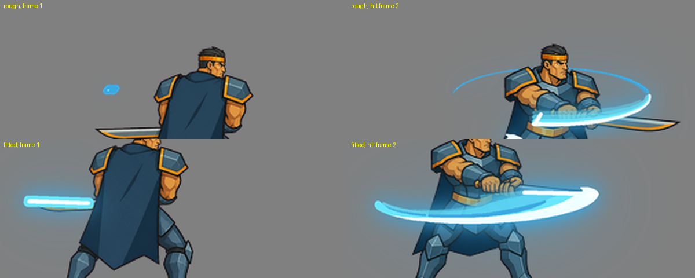
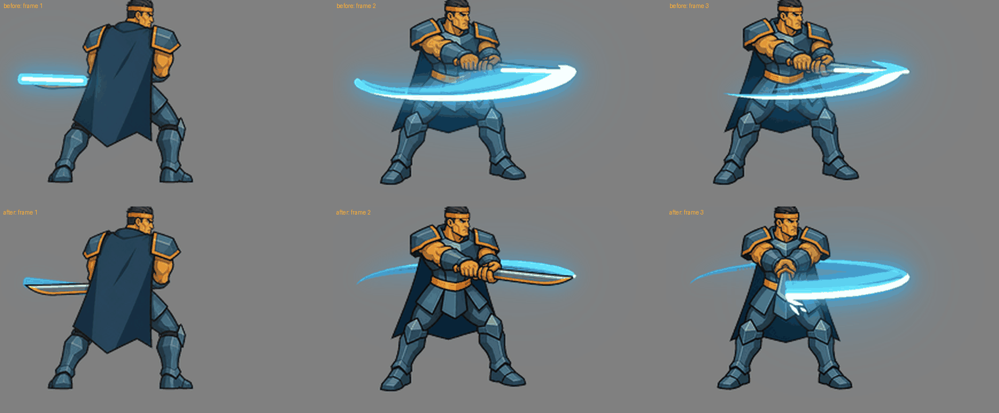

# Skill bằng cặp pose A/B + vfx + rig studio (phương pháp "alien")

Ghi ngày 2026-11-12. Nhân vật thử: `out/heroes/azure_blade` (hero, cỡ M), skill 1 "Trảm Trăng Khuyết". Kết quả: người dùng đánh giá hai pose "đúng ý 100%".
Phân tích gốc của phương pháp (đo trên `ref/alien`): phụ lục §9 cuối file này. Hướng dẫn công cụ: `docs/scripts/puppet_kit/puppet-kit-guide.md`, `docs/tools/studio/puppet-studio-guide.md`, `lib-fx/README.md`.

## 1. Ý tưởng

Một skill chuyển động kiểu "trước khung, sau khung" (A rồi B, mô tả 4 bước vươn, rút, co, đâm) làm video rất hay sai và phải làm lại cả clip.
Game tham khảo (`ref/alien`: 177 khung nhưng chỉ 81 hình khác nhau, chân đứng yên ở một hàng pixel, mỗi đòn khoảng 3 hình thân) **không vẽ chuyển động giữa hai tư thế**:

- Họ vẽ kỹ **hai tư thế chính**: A (chuẩn bị) và B (kết thúc).
- Một **vệt chém lớn** vẽ đúng đường quét của lưỡi từ A tới B, đặt vào khung đổi tư thế, che chỗ nhảy hình. Mắt người tự thấy "đã chém".
- Phần còn lại là sự sống nhỏ: thở, nhún, áo choàng vẩy.

Mình làm theo đúng cấu trúc đó, nhưng mỗi phần dùng công cụ phù hợp:

| Phần | Công cụ | Chi phí |
|---|---|---|
| Hai pose A, B | `fal-image` (gpt-image-2 low), mỗi pose một ảnh, A làm ảnh tham chiếu cho B | ~0,015 USD/ảnh |
| Sự sống của thân, tay, vai, áo choàng | Puppet Kit + dây chằng của Studio, pose-to-pose, hai pose đã duyệt | 0 USD |
| Vệt chém | bộ sinh slash của `lib-fx` (`scripts/slash_fx/`) + lớp bề mặt lưỡi quét, theo quỹ đạo gốc/mũi đao | 0 USD |

## 2. Ưu điểm và khuyết điểm

**Ưu điểm**
1. **Làm lại (retry) rẻ hơn video.** Sai một pose: làm lại đúng ảnh đó, ~0,015 USD (thực tế `costs.csv`: 0,0154 đến 0,0159). Một clip video `h3-max-turbo` 4 s: 0,06 USD (~4 lần), và sai thì mất cả clip cùng mọi thứ trong đó. Hai pose của azure_blade (A một lần, B ba lần thử) tốn 0,063 USD.
2. **Chủ động hoàn toàn với vfx.** Vệt chém tự host trong `lib-fx` và `source/vfx/`: sinh bằng code, đổi màu, độ dày, độ sáng, nhịp, vị trí chỉ bằng sửa tham số JSON. Không phụ thuộc model tự vẽ vệt (video hay vẽ vệt hồng, nhoè, sai hướng). Chạy lại ra đúng kết quả cũ (`PYTHONHASHSEED=0`).
3. **Tích hợp Studio và rig, nhân vật sống hơn.** Hai pose chỉ là ảnh tĩnh, rig tách thân, tay, đao và dây chằng vai-ngực cho nhịp thở, nhún theo quán tính, tay nảy, áo choàng vẩy, mà không đổi tư thế đã duyệt.
4. **Tất định và sửa được từng phần**: sửa nhịp là sửa số trong `make_anim.py`, sửa vệt là sửa `slash_params.json`, không gọi API.

**Khuyết điểm**
1. **Phụ thuộc 100% vào pose gốc phải chuẩn.** Rig 2D chỉ biến đổi nhẹ ảnh đã có (nhấc vài px, nghiêng vài độ). Không sửa được pose sai tay, sai chân, sai hướng đao hay sai cỡ. Pose sai là phải vẽ lại pose (mục 4, bước 2 và 3).
2. Không có chuyển động trung gian giữa A và B: cú vung dài một khung, do vệt chém che. Hợp đòn mạnh, ngắn; không hợp động tác cần thấy rõ từng bước (chạy, quay người).
3. Cần người duyệt bằng mắt từng pose; mô hình ảnh hay nhầm tay trái phải, hướng đao, độ nghiêng.
4. Cắt rig (đa giác cho tay, đao) vẫn do người hoặc AI đặt tay trên ảnh, sai số vài chục px; phải xem overlay.
5. Vị trí chân giữa hai pose không tự khớp: phải đo chân trước thủ công (`foot_marks.json`).

## 3. Cấu trúc thư mục của một skill (ví dụ azure_blade)

```
out/heroes/azure_blade/
  brief.md, history.md, meta.json
  source/design/
    master_v06.png                  master đã duyệt (cỡ chuẩn)
    pose_skill_crescent_p1_v01.png  pose A
    pose_skill_crescent_p2_v03.png  pose B
    prompts/pose_skill_crescent_p{1,2}_*.txt   prompt đầy đủ (ghi lại để chạy lại)
  source/rig/
    foot_marks.json                 x chân trước của từng ảnh (px ảnh gốc)
    make_rigs.py  -> rig_a.json, rig_b.json   (torso / blade / arms + dây chằng)
    make_anim.py  -> anims/crescent.json      (nhịp)
  source/vfx/crescent/
    weapon_marks.json               gốc/mũi đao của A và B (px ảnh gốc) + đường quét
    slash_params.json               màu, độ dày, trắng, mũi đậm/cán nhạt, quầng
    build_crescent.py               ghép thân puppet + vệt, ra GIF
  frames/skill_crescent_puppet_side/   thân (chưa vệt), xuất bởi puppet.py
  frames/skill_crescent_side/          thành phẩm có vệt: frames @2x @1x, preview_2x.gif, preview_game_1x_x3.gif, contact.png
```

## 4. Quy trình

### Bước 0: chuẩn bị
- Xác định **mặt phẳng của động tác** (song song màn hình, nằm ngang trên mặt đất, xéo, đâm thẳng) theo `.claude/skills/fal-image/action-planes.md`: nó quyết định cách tả hai pose và loại vệt dùng ở bước 7.
- Master đã duyệt (hero: `fal-image`; **không chibi, không dễ thương**, 3,5 đến 4,5 đầu; hai tay và hai chân cùng cỡ; áo choàng nằm sau thân; cả vũ khí trong khung. Xem `fal-image/format.md` "No chibi, no cute").
- Viết **mô tả skill** từng pha, theo vật lý (cầm, giơ, chém, tiếp đất), cho **hai pose duy nhất**. Không mô tả các khung giữa.

### Bước 1: viết prompt hai pose (chưa tốn tiền)
Lấy `{design}` nguyên văn từ master (script mẫu `out/heroes/azure_blade/source/design/prompts/mk_poses.py` ghép: `{design}` + vũ khí + mô tả pose + câu cấm + `{BG}` + `{STYLE}`). Mỗi pose gồm:

| Phần | Pose A (chuẩn bị) | Pose B (kết thúc) |
|---|---|---|
| Hướng nhìn | nghiêng hẳn, nhìn một phía | nghiêng hẳn, cùng phía |
| Tay | hai tay cùng nắm cán, nêu vị trí | như A, nêu vị trí mới |
| Vũ khí | nêu hướng lưỡi bằng **vị trí trên ảnh** (trái/phải của ảnh), không nói trái/phải của nhân vật | nêu rõ: nằm ngang song song đất, áp lên đất, **không cắm**; thấy đủ lưỡi |
| Áo choàng, lưng | rủ sau lưng | bị hất lên phủ lưng, thấy lưng |
| Thân | ngả nhẹ, chân vững | khom thấp, chân trước khuỵu, chân sau duỗi |
| Khung | vừa trong khung, ~75% | **chừa lề ≥ 8% mọi phía**, vẽ nhỏ hơn một chút |
| Cấm | không vệt, không bụi, không chuyển động, không bóng đất | như A |
| Ảnh tham chiếu | master | master **và pose A** (dặn: giữ nhân vật và cỡ, **không chép dáng**) |

### Bước 2: sinh và duyệt từng pose
```
python scripts/gen_image.py --prompt-file <prompt A> --size 1024x1024 --png --ref master_v06.png --name pose_skill_x_p1 --versioned --out <asset>/source/design
python scripts/gen_image.py --prompt-file <prompt B> ... --ref master_v06.png --ref pose_A.png --name pose_skill_x_p2 ...
```
- Mỗi lần một ảnh, xem bằng mắt, chấm theo checklist mục 5. Sai thì **chỉ làm lại pose sai**, sửa đúng một câu trong prompt (ví dụ lần đầu pose B cắm đao xuống đất thì sửa thành "lưỡi nằm ngang, áp lên đất").
- Người dùng duyệt; các bản không chọn xóa bằng `source_prune.py` cuối phiên.

### Bước 3: đo điểm bám (bằng mắt, có lưới)
- `foot_marks.json`: x chân trước (chân đứng yên) của từng ảnh. Chân này đứng yên giữa hai pose, thân lao tới.
- `weapon_marks.json`: toạ độ gốc (tsuba/cán) và mũi đao của A và B; đường quét: gốc đi theo đường cong qua trên đầu (`root_ctrl_up`, `root_ctrl_dx`), đao quay **thuận kim đồng hồ trên màn hình** qua hướng "lên" (hoặc ngược lại tuỳ động tác); `ease` cho gia tốc.
- Vẽ đường gốc-mũi lên ảnh (`debug_marks.png`) để kiểm tra có nằm đúng trên lưỡi không.

### Bước 4: tách rig và dây chằng
`python out/heroes/<id>/source/rig/make_rigs.py` ghi `rig_a.json`, `rig_b.json`. Mỗi rig:
- Xương `root` > `body` > `arms` (pivot ở vai).
- Ba lớp: `torso` (rest, gồm đầu, thân, chân, áo choàng; `fill_under` cho `arms` với `erode` lớn, `reach` nhỏ; `deform` làm áo choàng vẩy), `blade`, `arms` (hai tay, nắm đấm, giáp vai).
- Dây chằng `shoulder_chest` (`links`, `mode: stretch`): khi xương `arms` trượt (`tx`, `ty`), ảnh thân quanh vai và ngực đi theo. Vai nhô khi tay vươn, chìm khi tay đập xuống.
- Chạy `python scripts/puppet.py check <rig>` rồi xem `rig_overlay.png`: đa giác phải ôm đúng tay, nắm đấm, giáp vai, đao; **cạnh của đa giác `arms` không được cắt qua mặt** và không được ăn vào tóc.

### Bước 5: viết nhịp (4 pose của skill)
`make_anim.py` (một `anims/crescent.json`, 15 fps):

| Pose | Nội dung | Kênh chính |
|---|---|---|
| P1 | từ pose A, nâng đao hơi cao, hít vào, vai và ngực nhô | `arms.ty` -28, `arms.rot` -2,5, `body.sy` 1,022 |
| P2 | hạ về đúng pose A, thở ra, giữ | trả về 0, `body.sy` 0,992 rồi 1 |
| (cắt A→B, vệt che) | hit frame = khung đầu của pose B | |
| P3 | pose B (đập xuống), thân nén | `body.sy` 0,93 rồi nảy 1,015 |
| P4 | quán tính: nhún xuống, tay nảy, rồi về đúng pose B; sau đó thở nhẹ | `arms.ty` 20, -9, 6, -2, 0; `arms.rot` ±2 tắt dần; `torso.sway` 2,4 về 1 |

Đơn vị: `tx/ty` là px ảnh gốc 1024 (1 px ở @2x ≈ 7 px gốc). Biên độ phải **nhỏ**: bước dịch lớn nhất của thân giữa hai khung liền nhau chỉ ~2 px @2x (1 px cỡ game). Lần đầu lắc ngang cả người (34 px) bị người dùng chê "như động đất".

### Bước 6: xuất thân bằng Puppet Kit
```
python scripts/puppet.py init out/heroes/<id> --cell 176x140 --height 120     # một lần
python out/heroes/<id>/source/rig/make_rigs.py && python out/heroes/<id>/source/rig/make_anim.py
python scripts/puppet.py render out/heroes/<id> out/heroes/<id>/source/rig/anims/crescent.json --sheet skill_crescent_puppet_side
```
Thân ra `frames/skill_crescent_puppet_side/` (cell 352x280 @2x, chân ở pivot, cỡ thân chung `unit` = chiều cao thân của master).

### Bước 7: vệt chém (lib-fx)
`PYTHONHASHSEED=0 python out/heroes/<id>/source/vfx/crescent/build_crescent.py` (bắt buộc `PYTHONHASHSEED=0` vì `gen_slash_loop` đặt vết đứt bằng `hash()`).
- Gốc/mũi đao mỗi bước lấy từ `weapon_marks.json`; qua cùng phép đăng ký của rig nên vệt nằm đúng chỗ đao trong thân.
- Hai lớp: (a) bộ sinh layered `slash_from_track.py` (`scripts/slash_fx/`) (sợi, răng, vụn; mờ) và (b) **bề mặt lưỡi quét**: vẽ mọi đường gốc→mũi, nên dải **dày đúng bằng lưỡi**, mép dẫn song song lưỡi.
- Màu: đuôi xanh đậm, giữa xanh sáng, **đầu vệt trắng**, đường trắng mảnh theo quỹ đạo mũi; **mũi đậm và đục, cán nhạt và mờ**; quầng xanh.
- Đặt vệt: bước mọc đầu tiên trên khung cuối pose A (bắt đầu **đúng trên lưỡi pose A**), vệt đầy trên khung đầu pose B, rồi 3 khung tan. Không đặt vệt bước giữa lên thân pose A vì lưỡi trong thân vẫn ở vị trí cũ (lệch).

**Cách gọi mới (lib-fx fxkit, chưa dùng cho bản đã duyệt):** `build_crescent.py` ở trên vẫn là bản đã duyệt của `azure_blade`. Cách thay thế một lệnh, cùng số liệu `weapon_marks.json` đã đổi sang px ô @2x:
`python lib-fx/build.py melee/slash/crescent --from <mũi A> --to <mũi B> --track "root_a=<chuôi A>;root_b=<chuôi B>;up=35;turn=cw;ease=1.3" --pal frost --fps 15 --split --out <thư mục>`
(chi tiết: `lib-fx/_core/formulas/draw/FXKIT.md` mục 6). Khung thứ hai ở 15 fps (mọc xong) có mép dẫn trùng lưỡi pose B; kiểm tra bằng checklist "Vệt chém" mục 5.

**Cách thứ hai (fxkit), vệt mượt như bản đã duyệt:** dùng hiệu ứng `swing` (đầu vệt là lát mỏng trên lưỡi pose A, đầy với mép trắng dọc lưỡi pose B ở khung trúng đòn, tan 3 khung, mũi đậm chuôi nhạt):
`python lib-fx/build.py melee/slash/swing --from <mũi A> --to <mũi B> --track "root_a=<chuôi A>;root_b=<chuôi B>;up=35;turn=cw;ease=1.3" --pal frost --fps 15 --split --out <thư mục>`
Đặt `hit_frame` của fx (= 2) trùng khung trúng đòn của thân, nên khung fx đầu rơi vào khung cuối của pose A. `build_crescent.py` vẫn là bản đã duyệt của `azure_blade`.

### Bước 8: duyệt và chốt
- Xem `contact.png` và `preview_game_1x_x3.gif` (**duyệt ở cỡ game H = 60 px @1x**, không chỉ @2x).
- Ghi vào `brief.md` (manifest) và `history.md`; `source_prune.py` xóa bản không chọn.

## 5. Checklist bắt buộc

**Pose (bước 1-2)**
- [ ] Master đã duyệt; hero không chibi, không dễ thương (3,5 đến 4,5 đầu).
- [ ] Prompt pose A và B giữ `{design}` nguyên văn, ghi rõ hai tay cùng cỡ, hai chân cùng cỡ.
- [ ] Prompt **cấm mọi fx** (vệt, bụi, phát sáng, bóng dưới đất).
- [ ] Hướng đao và vị trí tay mô tả bằng vị trí trên ảnh, không bằng "trái/phải" của nhân vật.
- [ ] **Hướng thân là một tên cố định** (xem thân từ sau lưng, nhìn nghiêng thuần, mở ngực về phía người xem, hướng master) kèm danh sách "thấy" và "KHÔNG thấy" (`fal-image/action-planes.md` §4b); không dùng từ mơ hồ ("hơi xoay", "xoay hơn dáng ba phần tư một chút", "vặn người"): mô hình sẽ vẽ lại dáng mặc định của master (bài học 2026-11-14, pose A chém ngang).
- [ ] Phần bị che được tả là bị che, kèm phần còn thấy ("cán và hai tay nằm sau thân, chỉ nửa mũi đao thò ra bên trái ảnh").
- [ ] Sinh xong, **tự nhìn ảnh và đối chiếu từng dòng "thấy / không thấy"** trước khi gửi người dùng; một dòng sai là pose sai.
- [ ] Pose B dùng pose A làm ảnh tham chiếu, kèm câu "không chép dáng".
- [ ] Hai pose cùng hướng nhìn; nhân vật cùng cỡ gần bằng nhau (đầu rộng bằng nhau); ghi lại nếu lệch.
- [ ] Mỗi pose đạt theo mắt: đúng động tác mô tả, hai tay nắm đúng, vũ khí **nguyên cả lưỡi trong khung**, lề ≥ 8%.
- [ ] Người dùng duyệt từng pose trước khi dựng rig.

**Điểm đo và rig (bước 3-4)**
- [ ] `foot_marks.json`: đúng chân đứng yên (không phải mũi đao đang nằm trên đất).
- [ ] `weapon_marks.json`: đường gốc→mũi trùng lưỡi trong `debug_marks.png` ở cả A và B.
- [ ] Đa giác `arms` không cắt qua mặt, không ăn tóc; đa giác `blade` ôm kín lưỡi và cán.
- [ ] `fill_under` của `arms`: `erode` ≥ 10, `reach` ≤ 30 (nếu lớn thì lộ mảng tóc giả khi tay nhấc).
- [ ] **Không** `fill_under` cho phần đao nằm trên nền trống (sinh đao ma khi đao di chuyển).
- [ ] Dây chằng `shoulder_chest` có mỏ neo ở vai và ngực của lớp `torso` (không đặt trên lớp tay).
- [ ] `puppet.py check` chạy sạch, xem `rig_overlay.png`.

**Chuyển động (bước 5-6)**
- [ ] Không có lắc ngang cả thân; bước dịch thân lớn nhất giữa hai khung ≤ ~2 px @2x.
- [ ] Đúng bốn pose của mô tả: P1 nâng đao nhẹ, P2 về pose A, P3 pose B, P4 nhún và về pose B.
- [ ] Về **đúng** pose A / pose B ở cuối mỗi đoạn (kênh về 0 và 1).
- [ ] Hit frame = khung đầu pose B; ghi vào `anims/*.json`.

**Vệt chém (bước 7)**
- [ ] Chạy với `PYTHONHASHSEED=0`.
- [ ] Mũi đao ở khung vệt đầy khớp mũi đao của pose B; mép trắng nằm dọc lưỡi.
- [ ] Khung vệt đầu tiên bắt đầu trên lưỡi pose A, không có lớp nào lơ lửng.
- [ ] Độ dày = cả lưỡi; mũi đậm, cán nhạt; có trắng; đúng màu theo yêu cầu.
- [ ] Vệt tan hết trong vài khung, không biến mất đột ngột.

**Chốt**
- [ ] Xem GIF ở cỡ game (H = 60 px @1x); người dùng duyệt.
- [ ] `brief.md`, `history.md` cập nhật; `source_prune.py` chạy; ghi chi phí.

## 6. Chi phí thực tế (azure_blade, 2026-11-12)

| Hạng mục | Giá |
|---|---|
| Pose A (1 lần) | 0,0155 USD |
| Pose B (3 lần: cắm đao, hai bản nằm ngang) | 0,0155 + 0,0159 + 0,0159 = 0,0473 USD |
| Rig, nhịp, vệt chém, GIF | 0 USD |
| **Skill hoàn chỉnh (hai pose, có retry)** | **0,063 USD** |
| (Ngoài skill) 6 master thử, 3 chibi bị loại và 3 chiến binh | 0,091 USD |
| So sánh: một clip video 4 s | ~0,06 USD, mất cả clip khi sai |

## 7. Vướng mắc đã biết và việc nên làm tiếp
- Nét tóc nhỏ lộ giữa cánh tay xa và đầu khi tay nhấc cao (pose A). Có thể thêm một lớp đầu riêng hoặc giảm độ nhấc cánh tay xa.
- Pose B chỉ tách tay, chưa tách đầu.
- `build_crescent.py` còn hằng số cho nhân vật này (vị trí đặt vệt theo khung hit, màu xanh lam); khi dùng cho nhân vật khác cần tách ra tham số (tên pose, hit frame, màu).
- Chưa kiểm GIF ở cỡ @1x trên màn hình thật; hiện duyệt qua ảnh tĩnh và GIF phóng 3 lần.
- **Nợ kỹ thuật: chi tiết hiệu ứng trạng thái trên lưỡi** (`charge_blue`, `charge_fire`). Hiện đúng trải nghiệm nhưng hình còn đơn giản; cần so lại với `ref/vfx` (lửa: `element-trio/fire`, `swirl-slash`) và cải thiện: hình lưỡi lửa (nhịp bùng, tách mảnh, mòn từ mép), số lớp màu, tàn lửa có quỹ đạo, gradient mép và glow đúng số đo. Làm sau.
- Đòn cần xoay người, đổi mặt hoặc chạy vẫn phải dùng video (`video-sprite`) hoặc pose reel.

## 8. Tụ lực lưỡi đao (ánh sáng chạy trên lưỡi trước và sau skill)

Hiệu ứng thứ hai của skill, thêm 2026-11-12: năng lượng xanh dâng từ cán lên mũi đao trước đòn, rồi giữ sáng suốt đòn và sau đòn. Thử trên `azure_blade`; người dùng đã duyệt (2026-11-12).

- **Hiệu ứng nằm trong thư viện**: `lib-fx/melee/blade_aura/blade_aura.py` (`charge_blue`, xem một mình bằng `python lib-fx/build.py melee/blade_aura`). Luật vẽ: 4 tầng màu phẳng (xanh sẫm, xanh, băng, trắng; tầng sáng nhất sâu trong lưỡi và dưới đầu sóng), hai dải trong mờ ôm lưỡi, glow hai tầng, vài đốm bay lên vẽ "on twos".
- **Bám đúng lưỡi**: rig có hai socket `blade_root`, `blade_tip` gắn vào xương `arms` (`source/rig/make_rigs.py`). Ánh sáng vẽ lên **pixel của chính lưỡi** (render riêng phần `blade`, trừ phần `arms` đứng trước) nên không đè lên tay và đi theo cú nhấc đao.
- **Lớp riêng cho nhân vật**: `source/vfx/blade_charge/build_charge.py` + `aura_params.json` (mốc theo khung: bật nguồn khung 3, đầu sóng tới mũi khung 12, hai nhịp sóng, loé lúc chém khung 23, nhịp sóng định kỳ 10 khung ở pha giữ). Ra `frames/fx/blade_charge/` (một lớp RGBA mỗi khung body).
- **Ghép**: `PYTHONHASHSEED=0 python out/heroes/azure_blade/source/vfx/crescent/build_crescent.py --charge` đặt lớp tụ lực **dưới** vệt chém, ra `frames/skill_crescent_charge_side/`; bản đã duyệt `skill_crescent_side/` không bị đụng.
- **Hướng chạy**: từ cán tới mũi đúng nghĩa đen; ở pose A đao chúc xuống nên luồng sáng chạy xuống dưới màn hình. Cảm giác "dâng lên" đến từ độ sáng tăng dần và đốm bay lên.
- **Bản lửa `charge_fire`** (2026-11-12, người dùng đã duyệt: đúng hiệu ứng và trải nghiệm; bản sáng và rực: `strength` 0,85, `glow` 1,7, `tongue_scale` 1,3, 13 lưỡi): cùng lõi vẽ, cùng mốc thời gian và cùng toạ độ đao, khác bảng màu (đỏ sẫm, cam, vàng hổ phách, vàng nhạt, đo từ lửa phun đã tái tạo) và thêm lớp **lưỡi lửa** phẳng (cam, vàng bên trong, lõi nhạt) có kích thước, độ nghiêng và nhịp chập chờn riêng mỗi lưỡi, mọc lên từ đoạn lưỡi đã cháy; tàn lửa bay lên. Dựng: `build_charge.py --fire` rồi `build_crescent.py --charge=fire` (ra `frames/skill_crescent_charge_fire_side/`). Bản xanh không đổi (kiểm bằng hash khung).
- **Không tắt dần**: giữ nguyên tới cuối (hơi giảm sau cú chém, nhấp nháy theo nhịp thở).

## 9. Phụ lục: vì sao `ref/alien` làm được (đo trực tiếp trên khung)

| Đặc điểm | Số đo / quan sát |
|---|---|
| Cỡ | Nhân vật cao 32-41 px trong ô 168x112. Ở cỡ này mắt đọc bóng dáng và hiệu ứng, không đọc chi tiết khớp |
| Số hình | Chạy (0002-0006): **5 hình**. Đòn đánh đôi (0007-0032): 26 khung nhưng **~15 hình**; hầu hết mỗi hình giữ đúng **2 khung** (khung 0008, 0010, 0012... trùng 100% khung trước) |
| Lấy đà | Một tư thế giữ 6 khung (0007-0012), chỉ ánh sáng nhấp nháy (~600 px đổi) |
| Ra đòn | Đổi thẳng sang **tư thế mới**, không có khung chuyển tiếp, không nội suy |
| Hiệu ứng | Vệt chém hình lưỡi liềm **rất to** trong 2-3 khung, **che gần hết thân** đúng lúc đổi tư thế. Vệt chém gánh cảm giác chuyển động và che chỗ nhảy hình |
| Thiết kế | Cân đối, mập, chi ngắn, hai tay bằng nhau, chân bằng nhau, tay không đè lên thân; góc gần nhìn thẳng |
| Thân | Gần như không di chuyển; chạy chỉ nhún 1-2 px |

Cách họ làm (suy luận, chưa xác nhận): vẽ tay các **tư thế khoá** (rất có thể vector, tái dùng mảnh, đổi mảnh khi đổi tư thế), xuất ra cỡ nhỏ, giữ
khung on twos, và vẽ riêng vài hình vệt chém. Họ không mô phỏng vật lý từng khung: **người vẽ quyết định tư thế đúng**, hiệu ứng che phần còn lại.
Phương pháp ở file này thay "người vẽ tư thế đúng" bằng hai pose do model ảnh vẽ từng hình và người duyệt, còn vệt chém lớn che chỗ đổi pose.

## 10. Hai pose lệch nhau (A và B): đo, căn, khớp vệt

Thử trên cặp chém ngang đã duyệt của `azure_blade` (`pose_skill_sweep_p1_v02.png` nhìn từ sau lưng, đao ngang ngực chỉ sang TRÁI, nửa sau thân; `pose_skill_sweep_p2_v03.png` ngực mở, đao ngang chỉ sang PHẢI, đầy đủ trước thân). Hai ảnh **không khớp nhau**, và một vệt hình cố định (đặt tay `--from`, `u0`, `u1`) đặt lên sẽ trượt: ellipse nằm ở cổ, khung 1 chỉ là một chấm xa thân, vệt không chạm lưỡi B. Quy trình: đo cả hai ảnh, căn B vào A, rồi để lệnh dựng **tự suy ra** hình vệt từ các điểm đo. Số đo nằm ở `out/heroes/azure_blade/source/design/weapon_marks_sweep.json`.

### 10.1 Số đo (px của ảnh gốc 1024, tách nền magenta, kiểm bằng mắt trên ảnh có vẽ điểm)
| | A (v02) | B (v03) | B - A |
|---|---|---|---|
| mũi đao | (129, 464) | (1007, 424) | |
| đầu chuôi phần lưỡi nhìn thấy | (393, 483) (lưỡi chìm sau áo choàng) | (662, 416) (ló khỏi nắm tay) | |
| tâm thân (giữa hai giáp vai) | (598, 310) | (449, 300) | (-149, -10) |
| điểm giữa hai bàn chân (đáy ủng) | (541.8, 921) | (438, 940) | dx = -103.8, dy = +19 |
| cao (đỉnh đầu tới chân) | 812 | 852 (đỉnh đầu 88, chân 940) | tỉ lệ B/A = 1.049 |
Ghi chú: chân trái của B thấp hơn chân phải (951 so với 929), nên lấy trung bình; B to hơn A 4.9 %.

### 10.2 Chính sách căn: theo CHÂN, không theo thân
Phóng B với `scale_b_to_a = 0.953` quanh điểm giữa hai chân, rồi đặt điểm giữa hai chân của B lên của A. Lý do: hai pose được yêu cầu "chân đứng yên, thân xoay", nên chân là điểm duy nhất thật sự cố định giữa hai pose; căn theo thân sẽ làm chân trượt 100 px (của 1024) giữa hai khung. Phần dư còn lại là **thân B lệch 45.8 px sang trái so với thân A** (khoảng 5.6 % chiều cao, vẫn đọc được như thân xoay và nghiêng), và bàn chân của B không nằm trên một đường ngang (chênh 22 px) nên bàn chân phải của B nhấc lên nhẹ. Mọi toạ độ của vệt dựng **trên cùng hệ toạ độ đã căn** (hệ của A, nhân 0.2 thành px ô @2x); khi ghép, ảnh B cũng được phóng và đặt theo đúng phép đó. Sau căn: mũi B (1084.0, 429.2), đầu chuôi B (755.2, 421.6), tâm thân B (552.2, 311.0).

### 10.3 Khớp vệt vào các điểm đo
`--swing` nhận mũi A, mũi B và trục quay (`fit_swing` trong `lib-fx/_core/formulas/draw/fxkit/layers/slash.py`, mô tả ở `FXKIT.md` mục 6): với độ dẹt `k` đã chọn, mỗi mũi cho ra góc `u` và bán kính `r` của riêng nó, nên mép ngoài đi **đúng qua cả hai mũi**; bán kính và trục quay nội suy từ A sang B; mép trong và mép trắng nằm trên đường chuôi -> mũi của từng pose. Trục quay = tâm thân (x) ở độ cao của lưỡi (y), không phải ở cổ: A (598, 464), B (552.2, 415.2) sau căn. Lệnh thật (px ô @2x = toạ độ đã căn x 0.2, `k = 0.22` để bụng vệt không tụt quá thấp):
```
python lib-fx/build.py melee/slash/sweep --pal frost --fps 15 --split \
    --swing "tip_a=25.80,92.80;tip_b=216.81,85.85;pivot=119.60,92.80;pivot_b=110.45,83.05;root_a=78.60,96.60;root_b=151.05,84.32;k=0.22" \
    --out <thư mục>
```
Kết quả suy ra: u0 = 180 (mũi A nằm đúng trên trục dài), u1 = 6.8 (đao B chúc nhẹ xuống), bán kính 93.8 (A) và 105.2 (B) px @2x. Đặt `hit_frame` = 2 (khung B đầu tiên); khung 1 là thân A.
Trước / sau (dựng lại bản cũ: lệnh `--from 176,120 --to 261,120`, tâm thân đặt vào vai; hàng trên cũ, hàng dưới đã khớp):



### 10.4 Số đo nghiệm thu (px ô @2x, 15 fps, ghép trên nền xám: vệt sau dưới thân, vệt trước trên thân)
| Tiêu chí | Kết quả |
|---|---|
| (a) khung trúng đòn: mép ngoài tới mũi B | gần nhất 0.8 px, không vượt qua mũi (0 px) |
| (a) mép trắng so với đường chuôi B -> mũi B | trung bình 1.6, lớn nhất 4.5 px; phủ 100 % chiều dài lưỡi nhìn thấy (66 px) |
| (b) khung 1: lát mỏng so với phần lưỡi A nhìn thấy | trung bình 2.7, 95 % trong 5.3, lớn nhất 6.4 px (pixel quầng); chạm mũi A trong 0.3 px |
| (c) tâm vệt phần gần so với đường lưỡi | thấp hơn lưỡi 4.3 px tại chỗ gần nhất, trung bình 11.7 px (không chỗ nào cao hơn lưỡi) |
| (d) tan: A(h+1), A(h+2), A(h+3) so với A(h) | 0.60, 0.28, 0.08 (yêu cầu <= 0.75, 0.45, 0.2) |
Cặp tự nghĩ (mũi A (20, 560), mũi B (1220, 610): tầm dài hơn, đao thấp hơn): mép ngoài tới mũi B 1.0 px, mép trắng lớn nhất 5.6 px (trung bình 1.5), lát mỏng khung 1 lớn nhất 7.2 px, chạm mũi A 0 px, tâm vệt không cao hơn lưỡi (3.5 px thấp hơn). Dùng được cho điểm bất kỳ, không phải một hình cố định.

### 10.5 Sai số còn lại và khi duyệt cần nhìn gì
- Lát mỏng khung 1 là mảnh trắng có viền xanh nằm **đè lên** lưỡi A (nửa gần ở trước thân), không phải sau thân: nếu trục quay đặt thấp hơn mũi A thì mảnh rơi vào nửa xa, mờ và nằm sau lưỡi. Chọn y của trục bằng độ cao mũi A.
- Lưỡi cong (mũi nằm cao hơn thân lưỡi): đường chuôi -> mũi là dây cung, thân lưỡi thật thấp hơn tới ~10 px (ở cỡ @2x) so với dây cung; mép trắng đi dọc sống lưỡi.
- Bụng vệt tụt xuống ngang đai lưng (độ dẹt `k`): hạ `k` xuống 0.2 nếu thấy quá thấp; vệt đi trước thân ở mọi khung (không có nửa sau thân vì mũi A nằm trên trục dài).
- Phần thân B lệch 46 px so với A và chân phải B cao hơn chân trái 22 px là lỗi của ảnh, không phải của vệt: kiểm cả hai khi duyệt; nếu chướng mắt thì dịch rig, đừng dịch vệt.
- Cảnh báo còn lại của cổng (`build.py --check`): `cut` ở khung 5 (vệt còn 8-9 % đỉnh rồi hết ở khung 6).

### 10.6 Pose C (kết thúc cú chém ngang, chỉ vào người xem): thứ tự A -> B -> C, vì sao vệt đọc ngược khi chỉ có A và B, và cái gì sửa được (2026-11-14, viết lại sau khi sửa thứ tự)
**Triệu chứng.** Bản khớp hai pose (10.3 - 10.5) đạt mọi số đo (mép ngoài qua hai mũi, mép trắng trên lưỡi B) nhưng người duyệt đọc vệt chạy **phải sang trái**. Số liệu đúng hướng (mũi A ở trái -> mũi B ở phải, đuôi rút trước), nhưng hình đọc ngược vì hai lẽ:
1. Vệt là **bề mặt lưỡi quét**; lưỡi nằm dọc đường đi của chính nó ở hai đầu cung nên bề mặt mảnh dần về phía mũi: dày nhất ở trái-giữa, mảnh thành kim ở phải: một sao chổi có đầu ở TRÁI.
2. Cả vệt hiện đủ trong một khung, nên không có đầu nào được thấy đi qua.
Hai pose cũng không cho biết ellipse: `k` phải đoán (0.22). Điểm gần nhất của cung (lưỡi chỉ vào người xem) không có trong hai ảnh.

**Sửa lần 1 sai thứ tự (đã thay).** Vòng trước coi pose C (lưỡi chỉ vào người xem) là pose GIỮA của cung 180 độ đi qua nửa gần: thứ tự A -> C -> B. Người dùng định nghĩa lại và đó là định nghĩa chuẩn: **A** = hông xoay ra sau, đao ở sau thân chỉ sang TRÁI (`pose_skill_sweep_p1_v02.png`); **B** = đao đã đi khoảng 2/3 cung, chỉ sang PHẢI và hơi xuống (`pose_skill_sweep_p2_v03.png`); **C** = KẾT THÚC cú chém và là pose trúng đòn, đao chỉ thẳng vào người xem, rút ngắn thành nêm chúc xuống ảnh (`pose_skill_sweep_p3_v01.png`). Thứ tự đi và thứ tự khung: A -> B -> C, C là khung cuối và khung trúng đòn. Hỏi người dùng chọn cung nào, họ chọn **cung 270 độ**: mũi đi từ trái (sau thân) QUA NỬA XA (nửa ellipse sau thân, phần trên, mảnh và mờ, vẽ ở lớp sau nên thân che) sang phải (B), rồi vòng lại qua nửa GẦN về phía người xem (C). Quy ước góc của code: 0 = trước (phải), 90 = gần người xem nhất (đáy ellipse), 180 = sau (trái), 270 = xa (đỉnh); đường đi là u: 180 -> 270 -> 360 (quanh B) -> 450 (= 90, C), góc tăng, tổng +270.

**Sửa.** Đổi `lib-fx` (`FXKIT.md` mục 6): ellipse khớp qua BA mũi theo thứ tự đi (`tip_a` đầu, `tip_b` giữa, `tip_c` cuối; `k` tự khớp; góc mở liên tục, không có lỗi nhảy `atan2`), và nét "lead": đầu dày nhất, cụt, sáng, có mép trắng chạy dọc mép ngoài; đuôi kim; đầu đi qua ba khung A -> B -> C.

**Số đo (px của ảnh gốc 1024, tách nền magenta, vẽ điểm lên ảnh để kiểm bằng mắt; file `weapon_marks_sweep.json`, khoá `pose_c`, `offsets`, `aligned_in_order`).**
| | A (v02) | B (v03) | C (p3_v01) |
|---|---|---|---|
| mũi đao | (129, 464) | (1007, 424) | (502, 537) |
| đầu chuôi phần lưỡi nhìn thấy | (393, 483) (lưỡi chìm sau áo choàng) | (662, 416) | (502, 405) (chỗ lưỡi rời nắm tay) |
| tâm thân (giữa hai giáp vai) | (598, 310) | (449, 300) | (501.5, 270) |
| điểm giữa hai bàn chân | (541.8, 921) | (438, 940) | (496.25, 952.5) (hai ủng cùng mức, lệch 1 px) |
| cao (đỉnh đầu tới chân) | 812 | 852 | 866.5 (đỉnh đầu 86) |
| tỉ lệ về A | 1 | 0.9531 (B to hơn A 4.9 %) | 0.9371 (C to hơn A 6.7 %) |
| lệch chân A -> B, B -> C | A -> B: dx = -103.8, dy = +19 | B -> C: dx = +58.25, dy = +12.5 | (A -> C: dx = -45.5, dy = +31.5) |
| lệch tâm thân A -> B, B -> C | A -> B: (-149, -10) | B -> C: (+52.5, -30) | (A -> C: (-96.5, -40)) |
Sau căn theo chân (hệ của A, px của ảnh gốc): mũi A (129, 464), mũi B (1084.0, 429.2), mũi C (547.1, 531.6); lệch mũi A -> B (+955.0, -34.8), B -> C (-536.9, +102.4); chuôi B (755.2, 421.6), chuôi C (547.1, 407.9); lệch tâm thân sau căn A -> B (-45.8, +1.0), B -> C (-5.5, -29.6), A -> C (-51.3, -28.6). Lưỡi C dài 132 px, bằng 38 - 40 % phần lưỡi nhìn thấy của B (345 px).

**Lệnh ba điểm với số thật** (px ô @2x = toạ độ đã căn x 0.2; `pivot_b` có y = độ cao đường lưỡi B trừ 14, `pivot_c` có x = tâm thân C, y = độ cao nắm tay vì tay là trục của lưỡi ở C; không ghi `k`, không ghi `via` nên đi qua nửa xa):
```
python lib-fx/build.py melee/slash/sweep --pal frost --fps 15 --split \
    --swing "tip_a=25.80,92.80;tip_b=216.81,85.85;pivot=119.60,92.80;pivot_b=110.45,83.05;root_a=78.60,96.60;root_b=151.05,84.32;tip_c=109.43,106.33;pivot_c=109.33,81.59;root_c=109.43,81.59" \
    --out <thư mục>
```
Khớp ra: **k = 0.195**; góc u = **180.0 (A), 367.7 (B), 450.0 (C)** độ, tức A -> B +187.7, B -> C +82.3, tổng +270; bán kính **93.8 (A), 105.1 (B), 109.7 (C)** px @2x; `fc` = 0.695 (B nằm ở 0.695 của đường đi, không phải đúng nửa: B ở 2/3 cung chứ không ở 50 % góc). Mũi B không ở đúng u = 360 mà 7.7 độ sau đó, nên chỗ B không phải điểm cực phải mà là ngay sau nó. Hướng nhìn lấy theo phía của `tip_b` (phải), và `--from` / `--to` mặc định là `pivot` / `tip_c`. Thân ghép: khung 1 thân A, khung 2 thân B, khung 3 trở đi thân C (cắt giữa các pose, không có pose chen); `hit_frame` = 3.

**Đường đi: nửa xa trước, nửa gần sau.** Đoạn A -> B (góc 180 -> 367.7) đi qua đỉnh ellipse (u = 270): nằm ở lớp sau, mảnh, tông nguội, bị thân che một phần; đoạn B -> C (367.7 -> 450) đi qua nửa gần: lớp trước, dày, sáng, đè lên thân. Mỗi quãng giữa hai pose có góc, bán kính, trục quay và đầu chuôi nội suy tuyến tính, nút ở B.

**Vì sao chiều đi có thể đọc ngược ở đoạn cuối, và cái gì sửa.** Đoạn B -> C chạy từ PHẢI sang TRÁI trên màn hình, ngược với thói quen đọc trái sang phải; nếu vệt cuối mảnh hơn đầu hoặc cả vệt hiện cùng lúc thì mắt đọc đuôi như đầu. Ba thứ giữ cho nó đọc đúng: (1) đầu dày nhất, sáng nhất, cụt và có mép trắng ở chỗ mũi đang đứng (C), đuôi là kim mảnh nằm SAU đầu và rút trước (bề dày không giảm từ đuôi tới đầu); (2) đầu di chuyển qua các khung (khung 1 lát mỏng trên lưỡi A, khung 2 đầu ở B, khung 3 đầu ở C, khung 4 trở đi đuôi rút về phía đầu); (3) tia lửa / vệt tốc độ chỉ bắt đầu từ mũi C và chạy xuống về phía người xem, không có mũi tên trắng dài đè lên đầu. Đọc GIF ở tốc độ thường: đầu đi trái -> (sau thân) -> phải -> vòng về phía người xem.

**Trước / sau** (hàng trên: bản hai pose A, B của 10.3, đọc ngược; hàng dưới: ba pose A, B, C, các khung 1 - 3):



**Hai lỗi hình của vòng trước, đã sửa (so với bản A, C, B).** (a) Thanh trắng đứng có góc vuông cạnh nắm tay ở pose C: mép trắng trước đây là dải bề rộng không đổi nằm trên đường lưỡi của đầu, mà lưỡi C rút ngắn thành nêm thẳng đứng nên thành thanh đứng. Nay mép trắng là một dải chạy dọc MÉP NGOÀI của nét (theo đường mũi, từ mảnh tới 3.6 px ở đầu, chỉ ở nửa gần); riêng khung 1 (lát mỏng trên lưỡi A) vẫn nằm trên đường lưỡi A. (b) Mũi móc ngược ở đầu bên phải và cái nêm trong mờ phía trên nét chính: móc do mép trong của nét dày bị gập lại qua đường đi ở hai đầu ellipse dẹt (bán kính cong chỉ 4 px ở B, nhỏ hơn bề dày); nêm là sợi "faint" (hilt) mờ 40 %. Nay: nét dựng bằng từng tứ giác nhỏ, đầu cắt vuông góc với đường đi tại mũi (không gì nằm sau đầu dọc đường đi), bỏ sợi faint, 20 % cuối pháp tuyến xoay về đường lưỡi.

**Số đo nghiệm thu** (px ô @2x, 15 fps, ghép trên nền xám, vệt sau dưới thân, vệt trước trên thân; vùng alpha > 0.5; đường đi A -> B -> C tính lại từ cùng công thức `fit_swing`).
| Tiêu chí | Kết quả |
|---|---|
| khung 2: đầu tới mũi B | 1.2 px (yêu cầu <= 4); dọc đường đi, nét vượt qua mũi B: 0 px; điểm xa nhất về bên phải mũi B: -0.8 px |
| khung 3: đầu tới mũi C | 0.7 px (yêu cầu <= 5); vượt qua C dọc đường đi: 0 px |
| khung 3: mép ngoài so với đường A -> B -> C | pixel đặc (alpha > 0.95) cách đường đi lớn nhất 0.5 px ngoài mép trên t = 0.1 - 0.94 (khung 2 trên t = 0.1 - 0.69: 0.5 px); 0.94 - 1.0 của đường đi: 7.5 px vì tia lửa bay ra từ mũi C, không phải mép nét (tắt `scraps` và `streaks`: -0.5 px); khoảng cách đường đi tới pixel nét gần nhất: <= 1.1 px |
| khung 2: phần vệt ở lớp sau (nửa xa) | 99.6 % tổng alpha; bị thân che 50.3 % (che một phần) |
| khung 1: lát mỏng so với đường lưỡi A nhìn thấy (đuôi -> chuôi), trung bình / p95 / lớn nhất | 2.6 / 5.6 / 6.5 px (gồm viền quầng) |
| bề dày dọc nét, tối đa đường kính nội tiếp theo 8 khoảng của tham số đường đi (cắt ở 3.5 % đường đi ngay chỗ đổi lớp trước / sau và ở nhát cắt đầu, vì khoảng cách tại mặt cắt mảnh đi theo cấu tạo) | khung 2: 4.0, 5.7, 8.0, 10.0, 12.0, 14.1, 16.5, 17.1 (không giảm); khung 3: 2.8, 4.5, 8.0, 10.0, 12.2, 11.3, 24.7, 28.0 (tụt lớn nhất 0.9 px, mức cho phép 2.8). Bề dày ở đầu: khung 2 17.1, khung 3 28.1 |
| tham số đường đi của đầu (0 ở A, 1 ở C) | khung 1: 0.062 (lát trên lưỡi A) -> khung 2: 0.674 (mũi B ở 0.695) -> khung 3: 0.997 -> khung 4: 1.0 (tăng chặt chẽ); khung 5 (ngưỡng alpha > 0.3, 31 pixel gần đường đi): 0.987, tức tụt 0.013 so với khung 4 (khoảng 2 px), coi là giữ trong dung sai đó; khung 6 trở đi không còn nét |
| tan: A(h+1), A(h+2), A(h+3) so với A(h), h = 3 | 0.707, 0.272, 0.018 (yêu cầu <= 0.75, 0.45, 0.2) |
| cổng chất lượng | `python lib-fx/build.py melee/slash --check`: không FAIL (cảnh báo cũ `pop`, `cut`, `linger`); `python lib-fx/_tools/fxkit_test.py slash`: đạt |
| hồi quy | `crescent`, `heavy`, `thrust`, `axe`, `axe_heavy` (30 fps) và `sweep`, `diag_down`, `diag_up`, `swing --track`, `sweep` với `--swing` thường, lệnh hai điểm của mục 10.3 (15 fps): 11 / 11 bản dựng giống nhau từng byte so với trước khi sửa (băm sha256 các PNG) |
Hai bộ ba tự nghĩ (khác hẳn pose thật, chỉ để chứng minh tổng quát; px ô @2x): (i) nhìn sang TRÁI, mũi A (246, 104), B (16, 94), C (128, 144), trục (132, 108): k khớp 0.27, góc 187.4 -> 341.7 -> 449.2, bán kính 117.3 / 124.0 / 128.4; đầu tới B 0.0 px, tới C 1.4 px; vượt qua B 0.6 px; bề dày khung 2 tăng 2.8 -> 20.9, khung 3 4.0 -> 33.5 (tụt 0.8 ở chỗ đổi lớp); tan 0.58 / 0.19 / 0.01. (ii) đi qua nửa GẦN trước (`via=near`, góc giảm) rồi lên nửa xa: A (12, 108), B (246, 112), C (140, 72), trục (132, 108): k khớp 0.36, góc 180.0 -> 11.3 -> -88.7 (liên tục, không nhảy), bán kính 120.0 / 109.0 / 103.0; đầu tới B 1.0 px, tới C 1.0 px; vượt qua B 0.9 px; tan 0.38 / 0.10 / 0.0; lát mỏng khung 1 lớn nhất 9.2 px vì chuôi A tự nghĩ nằm xa.

**Sai số còn lại và điều chưa đạt.**
- Đầu ở khung 2 (B) là nhát cắt phẳng dọc lưỡi (ngang), rộng 17 px nhưng mép trắng chỉ là một chấm nhỏ ở mũi (mép trắng chỉ vẽ ở nửa gần, mà đoạn gần của nét ở khung 2 rất ngắn): đầu sáng nhất vẫn là khung 3. Nét ở B không thể dày hơn nhiều mà không gập qua đường đi: bán kính cong của ellipse dẹt ở B chỉ 4.3 px; thay vào đó đầu bị cắt vuông góc với đường đi tại mũi (nhát cắt phẳng), phần thò qua bị bỏ.
- Phép đo bề dày bỏ 3.5 % đường đi quanh nhát cắt đầu và chỗ đổi lớp; số đo thô (khoảng cuối chứa nhát cắt) tụt 4.3 px ở khung 2 và 3.3 px ở khung 3 vượt mức 10 %: đó là hiệu ứng của mặt cắt, không phải nét mỏng đi, nhưng phép đo đã đổi cách tính; ghi rõ để người duyệt biết.
- Lát mỏng khung 1: lớn nhất 6.5 px, p95 5.6 (bản hai pose: 6.4): chưa đạt yêu cầu 6 px của vòng trước nếu tính theo lớn nhất.
- Thân C lệch -51.3 px (ngang) và -28.6 px (dọc, vì C là chính diện: giữa hai giáp vai ở y 270 so với y 310 của lưng A) so với thân A sau căn, chỉ lệch 5.6 px (ngang) so với thân B; C to hơn A 6.7 % (hơn B 1.7 %), bù bằng phóng về A quanh chân. `pivot_c` đặt theo nắm tay (y 81.6) và `pivot_b` theo đường lưỡi B trừ 14: `k` tự khớp phụ thuộc hai y này (y thấp hơn thì `k` lớn hơn): đổi y thì kiểm lại hình vệt.
- Tia lửa ở khung 3 - 5 bay xuống về phía người xem từ mũi C (arc 75 - 115 độ từ trục tâm thân -> C, 3 vệt dài 62 px): đã thu nhỏ, nhưng vẫn là phần dễ chướng mắt nhất ở khung trúng đòn.
**Khi duyệt cần nhìn gì.** (1) Đọc GIF ở tốc độ thường: đầu có đi trái -> (sau thân) -> phải -> vòng về phía người xem qua A, B, C không; (2) khung 2: nét có đứng ở lưỡi B, phần lớn nằm sau thân và cánh tay không; (3) khung 3: đầu cụt sáng nằm trên nêm lưỡi C, không có thanh trắng đứng, không có mũi móc; nét dày dần về phía C; (4) khung tan: phần còn lại nằm gần đầu C, đuôi rút trước; (5) mép trắng nằm trên mép ngoài, không trượt khỏi nét; (6) thân C lệch so với A, B: nếu chướng mắt thì dịch rig, đừng dịch vệt.
